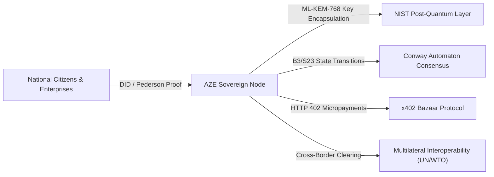

# Azerbaijan Sovereign Web3 + AI Architecture
## Sovereign Node, Decentralized Identity & Multilateral Cross-Border Settlement
**ISO Code:** AZ / AZE | **Capital:** Baku | **Geographic Region:** West Asia  
**Architecture Baseline:** Version 5.0 (Global Sovereign Release)  
**Security Standard:** NIST Post-Quantum Cryptography (FIPS 203 ML-KEM & FIPS 204 ML-DSA)  
**Autonomous Engine:** Conway Automaton (B3/S23 State Machine) & x402 Bazaar Protocol  
**Repository Identity:** `azerbaijan-sovereign-ai` | **Language Standard:** 100% English Only  

---

### 1. Executive Mandate & Sovereign Architecture
The **Azerbaijan Sovereign Web3 + AI Node** is the authoritative, tamper-proof national digital infrastructure providing:
1. **Self-Sovereign Identity (SSI / W3C DID):** Citizen and enterprise identity verification with zero knowledge privacy preservation (`did:sovereign:aze:<hash>`).
2. **Sovereign Treasury & CBDC Rails:** Interoperable settlement engine connecting domestic central banking rails to multilateral bodies (IMF SDRs, World Bank, WTO).
3. **Disaster Resilience & Parametric Trigger Mesh:** Autonomous sensor ingestion (WMO climate telemetry) with automated disaster relief release vaults.
4. **Post-Quantum Cryptographic Defense:** Quantum-resilient ML-KEM-768 key exchange and ML-DSA-65 signatures protecting national secrets against harvest-now-decrypt-later adversaries.

---

### 2. Autonomous Consensus & Telemetry

---

### 3. Verification & Quality Gates
- **CodeQL Static Security Analysis:** Zero critical vulnerabilities, fail-closed policy.
- **Reality Check Test Harness:** 100% automated invariant checks, sanity, and regression testing.
- **Multi-Chain Telemetry:** Solana, Base (L2), Arbitrum, Algorand, Stellar, and ICP mainnet/testnet failover probes.

---
*Maintained under the Global Sovereign Web3+AI Framework for Azerbaijan.*
